<!-- Header banner -->

  

  
  

---

##  About me

---

## 🛠️ Tech Stack

  <b>Frontend</b> 
  

  <b>Backend & Database</b> 
  

  <b>Mobile · Desktop · Hosting</b> 
  

  
  
  
  
  
  

---

## 🚀 Featured Projects

<table>
<tr>
<td width="50%" valign="top">

### 📬 TxHive
**Email SLA for company** · Web App

Real-time SLA tracking for company inboxes — timers per mailbox, at-risk & breach alerts, team dashboards.

   

</td>
<td width="50%" valign="top">

### 🧾 Purchase Requisition Portal
**Procurement approvals** · Web App

Multi-level approval chains, budget tracking, email notifications and a full audit trail from request to PO.

   

</td>
</tr>
<tr>
<td width="50%" valign="top">

### 👗 Maison Muse
**Dress rental & inventory** · CRM

Booking calendar that prevents double-bookings, dress inventory with sizes, deposits, returns and late fees.

  

</td>
<td width="50%" valign="top">

### 📦 Inventory System
**Stock & warehouse control** · CRM

Multi-location stock, in/out logs, supplier & PO management, low-stock alerts.

  

</td>
</tr>
<tr>
<td width="50%" valign="top">

### 🖥️ POS System
**Point of sale for retail** · Desktop App

Fast checkout with barcode scanning, receipt printing, daily sales reports — works offline and syncs later.

  

</td>
<td width="50%" valign="top">

### 🛒 E-Commerce Website
**Online storefront** · Website

SEO-ready store with catalogue & search, cart, checkout and an admin panel for orders.

  

</td>
</tr>
</table>

---

## 📊 GitHub Stats

  
  

